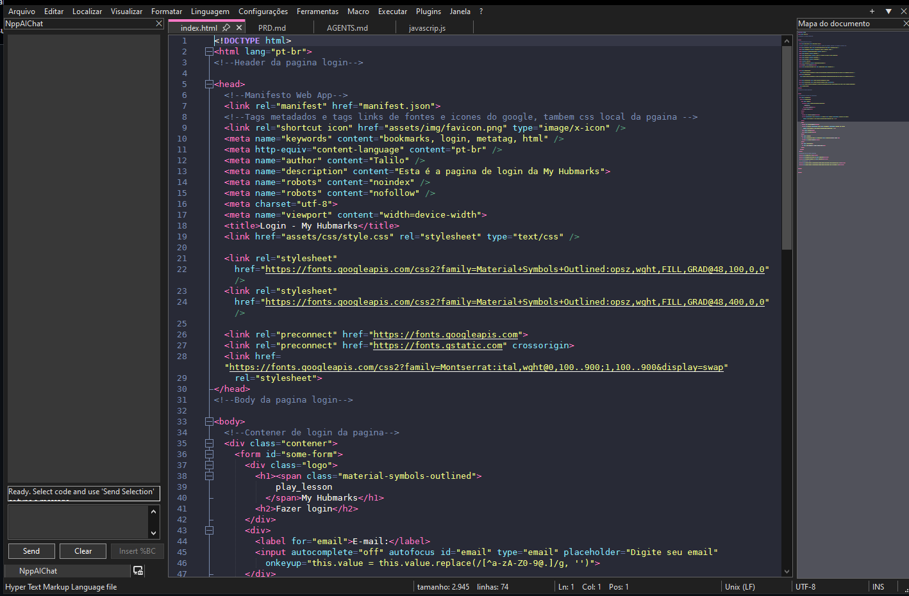

# NppAIChat para IDE Notepad++

Converse com modelos de Inteligência Artificial por meio de uma API sem sair do Notepad++. O **NppAIChat** disponibiliza um chat integrado ao editor para apoiar tarefas de programação e trabalhar com dúvidas e trechos de código durante a edição.



## Como o projeto funciona

O NppAIChat é um plugin para o Notepad++. Ele acrescenta uma interface de chat à IDE e utiliza uma API de inteligência artificial para enviar solicitações ao modelo configurado e exibir as respostas no próprio editor.

Em linhas gerais, o fluxo de uso é:

1. Abra o chat do NppAIChat no Notepad++.
2. Digite uma pergunta ou solicitação relacionada ao trabalho que está fazendo.
3. O plugin encaminha a solicitação ao serviço de IA por meio da API configurada.
4. A resposta é apresentada no chat para que você possa consultá-la enquanto continua trabalhando no Notepad++.

Isso permite manter a conversa e a edição de código no mesmo aplicativo. A qualidade e o conteúdo das respostas dependem do modelo e do serviço de API utilizados. Como em qualquer serviço externo, não envie chaves, senhas, tokens ou código confidencial sem antes verificar as políticas de privacidade e o tratamento de dados do provedor.

## Requisitos

- Windows e uma instalação do Notepad++ compatível com a versão do plugin.
- O pacote do NppAIChat disponível neste repositório: [`NppAIChat_v1.0.0.zip`](NppAIChat_v1.0.0.zip).
- Acesso à internet e uma credencial de API válida, caso exigidos pelo serviço de IA utilizado.

> O repositório também contém o instalador `npp.8.9.9.Installer.x64.exe`. Ele é o instalador do Notepad++ (versão 8.9.9, 64 bits), não é necessário se o Notepad++ já estiver instalado.

## Instalação manual

1. **Feche o Notepad++.** Isso evita que arquivos do plugin fiquem em uso durante a instalação.
2. Baixe o arquivo [`NppAIChat_v1.0.0.zip`](NppAIChat_v1.0.0.zip) deste repositório.
3. **Extraia o ZIP.** Você deverá obter a pasta do plugin.
4. Localize a pasta de plugins da instalação do Notepad++. Em uma instalação padrão de 64 bits, normalmente é:
   - `C:\Program Files\Notepad++\plugins`
   - ou, em algumas instalações, `C:\Program Files (x86)\Notepad++\plugins`
5. Copie a pasta do NppAIChat extraída para dentro de `plugins`. A estrutura deve ficar semelhante a esta (o nome exato da pasta pode variar conforme o pacote):

   ```text
   Notepad++/
   └── plugins/
       └── NppAIChat/
           └── ... arquivos do plugin ...
   ```

   **Importante:** copie a pasta descompactada do plugin para dentro de `plugins`; não deixe apenas o arquivo ZIP nessa pasta. Se o ZIP já contiver uma pasta `NppAIChat`, copie essa pasta inteira, sem criar um segundo nível `NppAIChat\NppAIChat`.
6. Se o Windows solicitar autorização para gravar em `Program Files`, confirme a operação com uma conta com permissão de administrador.
7. Abra novamente o Notepad++ e procure o NppAIChat no menu **Plugins**. Se não aparecer, confira a estrutura de pastas, a arquitetura/compatibilidade do plugin e reinicie o aplicativo.
8. Abra o chat do plugin e configure as informações de API solicitadas pela interface, se ainda não estiverem configuradas. Use uma chave válida do provedor correspondente e mantenha-a privada.

## Primeiro uso

Depois de abrir o chat, faça uma pergunta ou solicitação no campo de mensagem e envie-a. A resposta será exibida na conversa dentro do Notepad++. Por exemplo, você pode pedir uma explicação de um trecho de código ou ajuda para entender um conceito. Revise as respostas antes de aplicar alterações: conteúdo gerado por IA pode conter erros ou não se adequar ao seu projeto.

A configuração específica — como provedor, modelo, URL da API ou forma de informar a chave — depende do serviço e da versão do plugin. Siga os campos apresentados pela interface e a documentação do provedor; não compartilhe credenciais em capturas de tela, código público ou repositórios.

## Solução de problemas

- **O plugin não aparece no menu Plugins:** confirme que a pasta do plugin foi copiada para a pasta `plugins` da mesma instalação do Notepad++ que você abriu. Evite uma pasta duplicada criada durante a extração e reinicie o Notepad++.
- **A pasta não pode ser copiada:** feche o Notepad++ e verifique as permissões do Windows para a pasta de instalação.
- **O chat abre, mas a solicitação falha:** verifique a conexão com a internet, a configuração da API e se a credencial e o serviço estão válidos.
- **A instalação não é compatível:** verifique se a versão e a arquitetura do Notepad++ correspondem ao pacote do plugin.

## Documentação detalhada
- [ `Documentação` ] ([Handook](https://github.com/talilotarlison/NppAIChat-Notepad-plus-plus/blob/main/Handbook.md)) - Documentação detalha como usa API Gemini, Deepeseek, Cloud, OpenIA e OpenRouter.
## Arquivos neste repositório

- [`NppAIChat_v1.0.0.zip`](NppAIChat_v1.0.0.zip) — pacote do plugin para instalação manual.
- [`image.png`](image.png) — imagem de demonstração exibida nesta página.
- [`npp.8.9.9.Installer.x64.exe`](npp.8.9.9.Installer.x64.exe) — instalador do Notepad++ 8.9.9 para Windows 64 bits.

## Acesse ao Projeto Original
- [NppAIChat](https://github.com/isaacjuan/NppAIChat)
